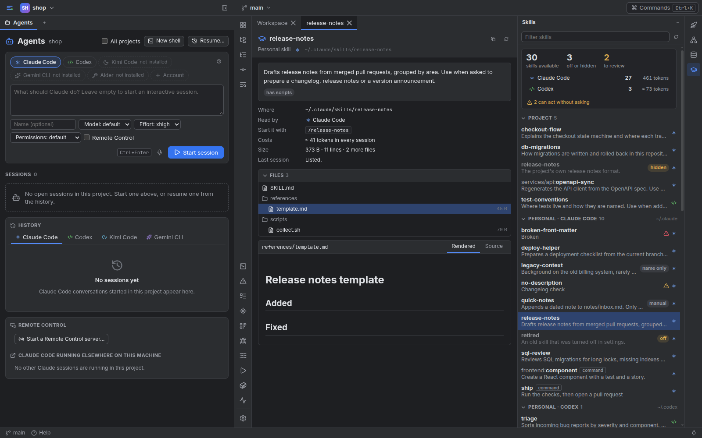

# Agent skills: what your agents can use, and Workbench's own

A **skill** is a folder with a `SKILL.md`: a name, a description that says when to use it,
and instructions the agent follows when it does. Claude Code, Codex, Gemini CLI and Kimi
Code all read the same format (the open [Agent Skills](https://agentskills.io) standard) but
from different folders, so "which skills can my agents use here, and what do they cost?"
is not a question any one of them answers. The **Skills** tool window does.

Open it from the right-hand stripe, or with Ctrl+K → *Show Agent Skills*. It is desktop
only, and read-only apart from installing and removing Workbench's own skills (below).

## The window

The summary at the top counts what the project's agents can load:

- **skills available**, and how many are **off or hidden**: turned off in settings, from a
  plugin that is not enabled, or hidden by another skill of the same name. Accounts are
  judged one by one: a skill that one account's settings turn off, or that its own personal
  skill hides, still counts as available while another account has it (its panel says for
  whom it is off), and two accounts that each have a personal skill of one name never hide
  each other.
- **to review**: skills with something to fix or look at (a click filters the list).
- one row per agent account with its skills and what their descriptions cost **every
  session** in tokens. A row is a filter too. For Claude Code the figure is what its newest
  session in this project really received when there was one (no "≈"); otherwise an
  estimate from the files.
- **can act without asking**: skills that pre-approve tools, register hooks or run shell
  commands when invoked. Open one to see which.

Below it the skills are grouped: the project's, each account's own, plugins (one group
each), claude.ai's synced skills, an organization's, and **Built in**: Claude Code's own
skills (`/init`, `/loop`…), which are in no folder and are known from the skill listing
Claude Code recorded in its newest session here (a skill removed after that session began is
in that listing too, so it shows there until the next session starts). Rows show what is off (`off`, `hidden`,
`name only`, `manual`) and warn when something needs a look; right-click copies a name or
its `/command`, or opens a project skill in the editor.

A row opens the skill's **panel**: its description and when to use it, where it is, which
agents read it, how to start it, what it costs, its size, what it can do on its own,
what is wrong with it, its files, and its text rendered or as source. Links in a skill's
text to its other files open in the same panel.

## Where each agent looks

| Agent | Its own folder (per account) | Shared | In the project |
| --- | --- | --- | --- |
| Claude Code | `~/.claude/skills`, claude.ai's synced skills, installed and enabled plugins' skills, `commands` | none | `.claude/skills` and `.claude/commands` from the project up to the repository root, and `.claude/skills` in folders up to three levels below it |
| Codex | `$CODEX_HOME/skills` and its bundled `.system` | `~/.agents/skills` | `.agents/skills` and `.codex/skills` from the repository root down to the project |
| Gemini CLI | `~/.gemini/skills` | `~/.agents/skills` | `.gemini/skills` and `.agents/skills` |
| Kimi Code | `$KIMI_CODE_HOME/skills` (loose `.md` files too) and its `extra_skill_dirs` | `~/.agents/skills` | `.kimi-code/skills` and `.agents/skills` at the repository root |

Accounts count: a second Claude Code account with its own `CLAUDE_CONFIG_DIR` has its own
personal skills and plugins, and the window shows them apart. Claude Code's plugin cache
keeps every version it ever fetched, so plugins are read through its registry
(`installed_plugins.json`) and only when enabled. Settings that turn skills off are
honoured: Claude Code's `skillOverrides` (`off`, `name-only`, `user-invocable-only`) and
Codex's `[[skills.config]]` with `enabled = false`. When two skills share a name, the one
the CLI would use wins and the other shows as `hidden` for that account (Claude Code: an
organization's over a personal over a project one; Kimi Code and Gemini CLI: the project's
over the personal; Codex lists them side by side and the window only remarks on it).

Not covered: the skills Codex, Gemini CLI and Kimi Code bundle themselves, accounts inside a
dev container, and sub-agents and plugins' other parts.

## What a skill costs

An agent sees every skill's name and description in every session, whether or not it uses
the skill; the text loads only when it does. Claude Code cuts a description (with its
`when_to_use`) at 1,536 characters and keeps the whole listing within 1% of the model's
context window, shortening descriptions beyond that; Codex keeps its list within 2%. The
window estimates four characters to a token. A skill only you start (`disable-model-invocation`)
costs nothing, and one listed `name-only` costs its name. A skill in a sub-folder of the
project is listed only once an agent reads a file below it, so it is left out of the
per-session figure, and a skill Workbench may not read (a link out, below) counts by its name
only.

## What needs a look

A warning or an error on a row means one of:

- the front matter does not parse (Claude Code then loads the skill with no name and no
  description, so nothing can match it), or there is no description;
- the description is longer than the standard's 1,024 characters (or Claude Code's 1,536);
- the `name` differs from its folder, or is not a name the standard allows;
- the file is unreadable, not text, or larger than 256 KB (it is not read further);
- the text is over 500 lines (a remark);
- a skill of a repository, plugin or sync is a link out of it (nothing of it is read).

A note at the bottom of the window says when a look was cut short: more than 1,500 skills, a
folder of more than 5,000 names, or more reading than a bound allows in a repository's or a
plugin's folders or in the search through the project's sub-folders. Each of those has a bound
of its own, so a huge or hostile repository never keeps your own skill folders from being read.

## Safe to look at

The window only reads. `SKILL.md` and file names are read, never run: a skill's scripts are
shown as files and nothing starts. A repository's skills are untrusted text like any of its
files: the panel renders them the way Workbench renders every repository's Markdown
(sanitized), a file that is not a plain file is never opened, a skill from a repository, a
plugin or claude.ai's sync that is a link leading out of it is listed with a warning and not
read (agents follow such links; someone else's content must not make Workbench show your
files; your personal skills may link anywhere, as people link their own checkouts; a
repository that is your whole home folder, such as a dotfiles checkout, does not count as the
project's own: a project inside it keeps its links inside the project), sizes and folder walks
are bounded, and the browser never names a path: it asks for a skill by an id the server made,
and for a file by a name inside that skill's folder.

## Workbench's own skills

The Workbench group at the bottom lists a few optional skills that teach an agent to work
well inside Workbench. They are worth having because an agent meets Workbench's tools as
names and short descriptions, often loaded only on demand: a skill says *when* to reach for
them and in which order.

| Skill | An agent uses it to |
| --- | --- |
| `workbench` | pick the right tool (show a file or diff, CI and reviews, Confluence and Jira, runs, Local History), and know the etiquette and what Workbench never does for an agent |
| `workbench-report-card` | hand over a report, comparison or gallery as a Workspace card: sandbox-safe HTML, the shared style, the step types |
| `workbench-data-capture` | put a capture into the data viewer and read statistics back |
| `workbench-debug-session` | drive the debugger: start or attach, breakpoints, steps, registers, firmware on a probe |
| `workbench-project-setup` | write a project's `.workbench.toml` (runs, environments, debug launches, data sources) without guessing keys Workbench ignores, and show what belongs in your machine-only files for you to paste (it never writes those) |

They are embedded in Workbench and **never installed unless you ask**. Open one to read all
its files first, then **Install** it for a Claude Code or Codex account (the two CLIs that
get Workbench's tools): the files are copied into that account's own skills folder
(`~/.claude/skills/<name>/`, `$CODEX_HOME/skills/<name>/`) with a small marker,
`.workbench-skill.json`, that lists each file and its hash. From the marker Workbench knows:

- **installed**: the files are as this Workbench ships them;
- **update**: an older Workbench installed it and you did not edit it; **Update** replaces
  the files it wrote and removes the ones a newer version dropped;
- **edited**: you changed a file; nothing is replaced or removed without a confirmation
  (**Restore** puts Workbench's version back);
- **name taken**: a folder of that name exists that Workbench did not make; it is never
  touched. (A marker only means something in a folder named after one of these skills, directly in
  a Claude Code or Codex account's skills folder: anywhere else, a copy in the shared
  `~/.agents/skills` or in another CLI's folder included, it is ignored and the skill is an
  ordinary one.)

**Remove** deletes only the files Workbench wrote; anything you added there stays. A running
Claude Code session picks up a new skill when its skills folder was already watched,
otherwise use `/reload-skills` or start a new session. Codex still reads `$CODEX_HOME/skills`
but its source calls that location deprecated in favour of `~/.agents/skills`; Workbench
installs there anyway because it is the one folder that belongs to a single account (the
other is shared with CLIs that have no Workbench tools).

An installed skill's description is in the context of every session of that account, also
outside Workbench (about 130 tokens each), where its tools do not exist; each says so and
tells the agent to ignore it then. Install the ones you use. Agents cannot install or
remove skills: only a signed-in device, or the master token, can.

To use one without Workbench's help, copy a folder of the repository's `skills/` to where
your agent reads skills.

## For contributors

Workbench's skills live in `skills/<name>/` (`SKILL.md`, and `references/*.md` for detail an
agent reads on demand). They are text only, use the portable front matter (`name`,
`description`, `license`, `compatibility`), and a test keeps them honest: every
`workbench`-server tool a skill names must exist, every link in it must resolve, every TOML
example must parse as the file it says it is, and the front matter must parse. The
architecture notes are in [ARCHITECTURE.md](ARCHITECTURE.md#agent-skills-skills).
